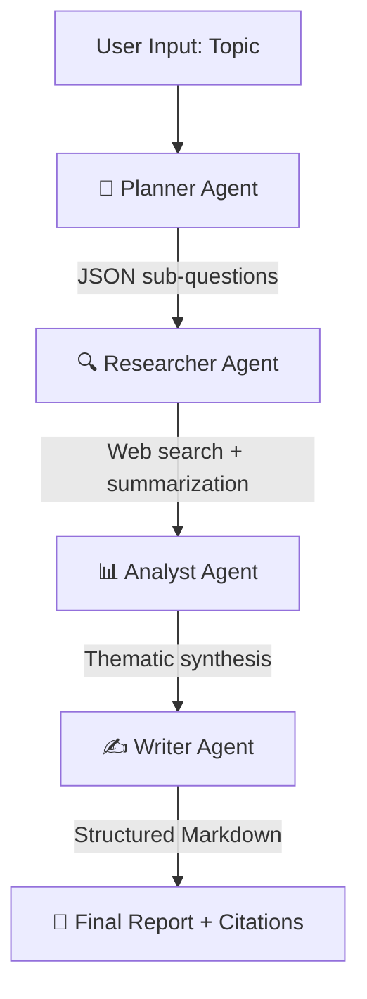

<div align="center">

# 🔬 Agentic Research Assistant

**A multi-agent AI system that autonomously researches any topic and generates cited, structured reports.**

[](https://python.org)
[](https://langchain.com)
[](https://streamlit.io)
[](https://groq.com)
[](https://opensource.org/licenses/MIT)

[**Live Demo**](https://agentic-research-assistant-laksh.streamlit.app/) · [**Architecture**](docs/architecture.md) · [**Report Bug**](https://github.com/tigayalakshit7-stack/agentic-research-assistant/issues)
</div>

---

## 🎯 The Problem

Traditional research workflows are slow and manual: you search the web, read multiple sources, take notes, synthesize findings, and write a report. Generic LLM chatbots hallucinate facts and can't cite sources. RAG systems solve citation but don't autonomously decide *what* to research.

**This project solves all three.** Give it a topic. It plans, researches, analyzes, and writes — producing a cited, structured report grounded in real web sources.

---

## 🏗️ Architecture

The system uses **four specialized agents** orchestrated in sequence, each with a single responsibility:



| Agent | Responsibility | Input | Output |
| :--- | :--- | :--- | :--- |
| 🧠 **Planner** | Decompose topic into focused sub-questions | Raw topic string | JSON array of `{question, rationale}` |
| 🔍 **Researcher** | Search web + summarize each sub-question | One sub-question | Findings + source URLs |
| 📊 **Analyst** | Synthesize findings into themes | All findings | Thematic prose analysis |
| ✍️ **Writer** | Compile final report with citations | Analysis + sources | Markdown report |

Full diagrams: [`docs/architecture.md`](docs/architecture.md)

---

## ⚙️ Key Engineering Decisions

### 1. Three-Model Fallback Chain

Groq's free tier rate-limits per model. To avoid pipeline failures mid-run, every LLM call is wrapped in a **fallback chain**:

```
GPT-OSS-120B  →  Qwen3.8-27B  →  Llama-3.3-70B
```

If a model hits its rate limit or errors, the next one takes over automatically via LangChain's `.with_fallbacks()`. This **triples** the effective daily request quota without any paid tier.

### 2. Citation Integrity

LLMs hallucinate citation numbers (e.g., citing `[9]` when only 4 sources exist) and fabricate statistics. To prevent this:

- The Writer prompt **forbids** citation numbers outside the actual source range
- The reference list is **appended programmatically** after generation, not written by the LLM
- Temperature is lowered to `0.3` for the Writer to reduce creative drift
- If no sources are found, the report says **"evidence is limited"** instead of inventing facts

### 3. Junk Source Filtering

General web search returns commercial blogs, dictionary definitions, homepages, and configuration files. The search layer filters these via:

- **Domain blocklist** (dictionary sites, encyclopedias, social media)
- **URL pattern matching** (`.json`, `.pdf`, `.well-known/`, Stack Overflow Q&A)
- **Preferred domain scoring** (`.edu`, `.gov`, `arxiv.org`, `pubmed`, `nature.com`)
- **Homepage detection** (results with no path are dropped)

### 4. Honest Failure Modes

When search returns nothing usable, the system **does not hallucinate**. It writes a report that:

- States clearly that no substantive sources were retrieved
- Marks every unsupported claim as **"evidence is limited"**
- Still produces a coherent report structure (Executive Summary → Conclusions)

This is a deliberate design choice: **a research tool that lies is worse than one that admits gaps.**

---

## 🛠️ Tech Stack

| Layer | Technology | Why |
| :--- | :--- | :--- |
| **Orchestration** | LangChain + LangGraph concepts | Chain composition, fallbacks, prompt templates |
| **LLM Provider** | Groq (free tier) | Extremely fast inference (~500 tok/s), no cost |
| **Models** | GPT-OSS-120B · Qwen3.8-27B · Llama-3.3-70B | Best-in-class free models with distinct fallback roles |
| **Web Search** | DuckDuckGo (`ddgs`) | Free, no API key required |
| **Data Models** | Pydantic v2 | Type-safe state, validated agent outputs |
| **UI** | Streamlit | Fast prototyping, custom CSS for polished look |
| **Language** | Python 3.11+ | Industry standard for AI engineering |

---

## 🚀 Quick Start

### Prerequisites

- Python 3.11 or higher
- A free [Groq API key](https://console.groq.com)

### Installation

```bash
# Clone
git clone https://github.com/tigayalakshit7-stack/agentic-research-assistant.git
cd agentic-research-assistant

# Virtual environment
python -m venv venv
source venv/bin/activate   # Windows: venv\Scripts\activate

# Dependencies
pip install -r requirements.txt

# API key
echo "GROQ_API_KEY=your_key_here" > .env

# Run
streamlit run app.py
```

Open `http://localhost:8501`, enter a topic, and watch the agents work.

---

## 📊 Example Output

**Input:** *"The impact of AI on healthcare diagnostics"*

**Output:** A structured report with:
- Executive summary
- Comparison table of AI technologies across medical specialties
- Real citations (PMC, ScienceDirect, Nature)
- Identified research gaps
- Downloadable as Markdown

Sample reports are in [`examples/`](examples/).

---

## ⚠️ Known Limitations

**This is v1.0. Here's what's honest about it:**

1. **Search quality varies.** DuckDuckGo is a general web engine, not a research index. For mainstream topics (healthcare, climate, tech), it works well. For niche topics ("AI impact on thieves"), it may return limited or off-topic results.

2. **No source verification.** The system trusts the URLs returned by search. It does not verify that the sources are peer-reviewed or that the snippets match the actual article content.

3. **Narrow scope per agent.** Each agent has one job. There is no self-reflection loop, no iterative refinement, and no critic agent to evaluate outputs.

4. **Free-tier rate limits.** Groq's free tier allows 30 requests/minute and 1,000/day per model. Heavy usage triggers the fallback chain, which buys time but is not unlimited.

---

## 🔮 Future Work

- [ ] **Academic source integrations** — Semantic Scholar API, arXiv API, CrossRef
- [ ] **Source credibility scoring** — rank results by citation count and venue
- [ ] **Self-reflection loop** — Critic agent reviews the Writer's output and requests revisions
- [ ] **Parallel research** — run sub-question research concurrently instead of sequentially
- [ ] **Export formats** — PDF, DOCX, HTML in addition to Markdown
- [ ] **Caching** — cache search results and LLM calls for repeated queries
- [ ] **Evaluation harness** — automated tests for citation accuracy and source relevance

---

## 📁 Project Structure

```
agentic-research-assistant/
├── app.py                    # Streamlit UI
├── requirements.txt
├── .env                      # GROQ_API_KEY (gitignored)
├── src/
│   ├── config.py             # Constants
│   ├── state.py              # Pydantic models
│   ├── llm_factory.py        # 3-model fallback chain
│   ├── graph.py              # Pipeline orchestrator
│   ├── agents/
│   │   ├── planner.py
│   │   ├── researcher.py
│   │   ├── analyst.py
│   │   └── writer.py
│   └── tools/
│       └── search.py         # Research-tuned search layer
├── docs/
│   └── architecture.md       # Mermaid diagrams
└── examples/                 # Sample generated reports
```

---

## 🤝 Contributing

Issues and pull requests welcome. For major changes, open an issue first.

## 📄 License

MIT — see [`LICENSE`](LICENSE).

---

<div align="center">
<i>Built by <a href="https://github.com/tigayalakshit7-stack">Lakshit Tigaya</a> · Architecting AI systems that ship.</i>
</div>
